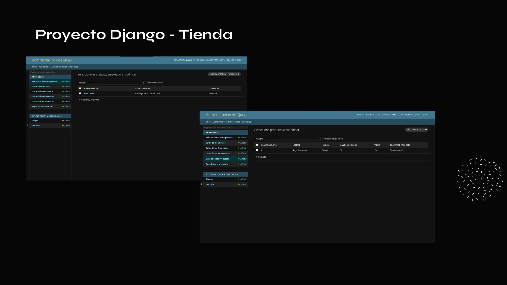

# Mi Tiendita — Gestión de Tienda con Django

Aplicación web administrativa desarrollada con **Django** para la gestión de inventario, productos, clientes, proveedores, empleados y control de asistencia mediante el panel **Django Admin**.

## Vista previa

## Características principales

- **Empleados y asistencia:** Registro de empleados (datos básicos, CUI y teléfono) y control de asistencia con fecha automática.
- **Clientes y proveedores:** Administración de clientes (NIT, residencia y estado) y catálogo de proveedores por rubro.
- **Productos e inventario:** Gestión de productos (marca, cantidad, precio, disponibilidad y proveedor) y registros de conteo de inventario.
- **Panel administrativo:** Interfaz de gestión construida sobre **Django Admin** en español (`es-gt`).

## Tecnologías utilizadas

- **Python 3.10**
- **Django 4.0.4** (ORM, migraciones y Django Admin)
- **SQLite** (base de datos local por defecto)
- **Pipenv** (`Pipfile` y `Pipfile.lock`)

## Contexto y estado del proyecto

- **Contexto:** Proyecto académico desarrollado en mayo de 2022 que conserva su implementación original (modo `DEBUG = True` y `SECRET_KEY` de ejemplo en `settings.py`; no preparado para producción).
- **Estado:** Finalizado (archivado para portafolio; `db.sqlite3` excluido mediante `.gitignore`).

## Autor

**Daniel Alejandro Arita Leiva**
